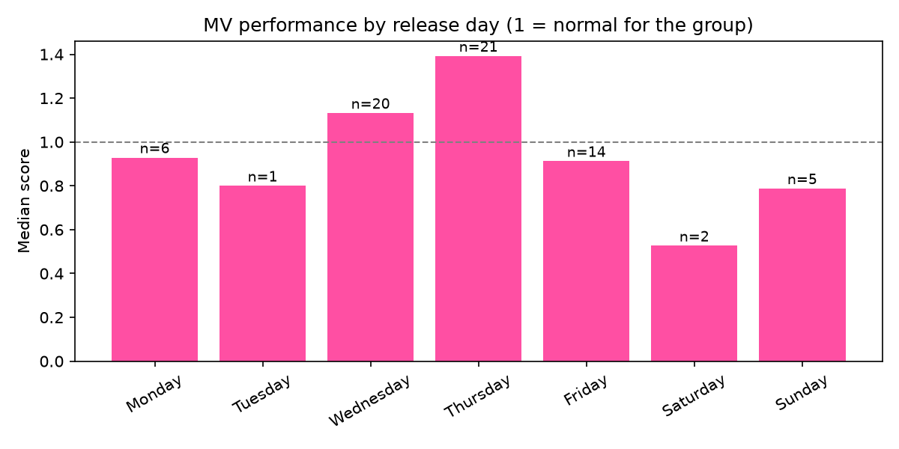
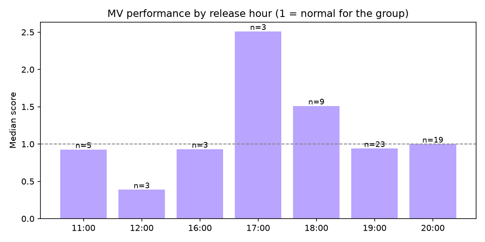
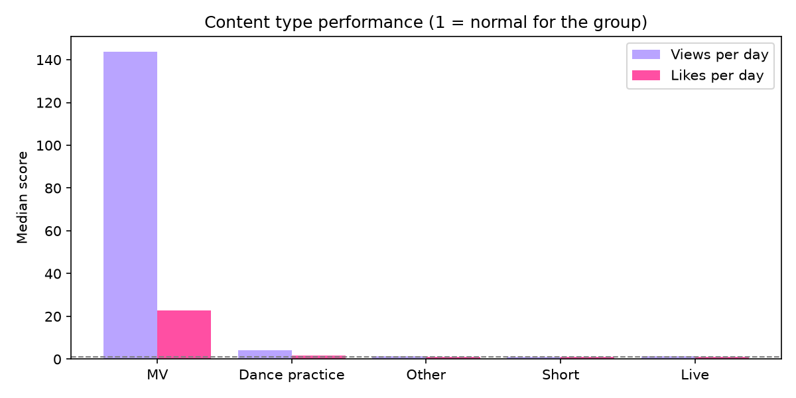
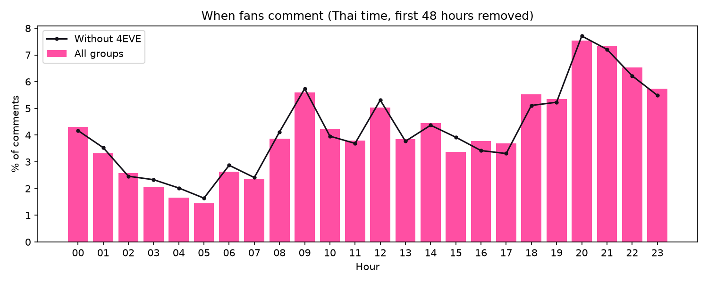
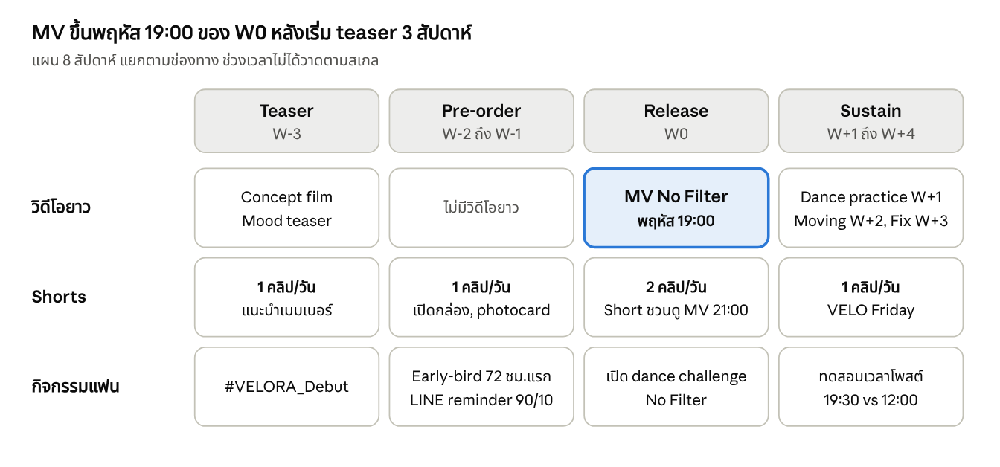

# VELORA Fan Engagement Campaign

Data-driven launch plan for **VELORA**, a fictional T-pop girl group, using YouTube data from 8 real T-pop girl groups.

> **Fictional artist — concept project.** VELORA, its members and its album are made up for this portfolio. All market data comes from public YouTube data.

## Summary

I collected 8,079 videos from 8 T-pop girl group channels and used them to answer three launch questions for VELORA's debut single.

| Question | Answer |
|---|---|
| When should the debut MV come out? | **Thursday 19:00.** Release day and time have only a small effect on views, so I picked a safe slot with less competition |
| What content should VELORA post? | **MV for reach, Shorts for fan engagement, and more dance videos.** MVs are 0.5% of uploads but 35% of views. Shorts get 76% of likes. Dance practice videos do well but almost no group makes them |
| When should Shorts be posted? | **19:30-20:00 on weekdays, 18:00 on weekends.** Fans comment most between 20:00 and 22:00 |

The three results fit together: the MV goes up at 19:00, one hour before fans are most active.

These results are turned into a [campaign plan](#4-campaign-plan) with a launch timeline, pre-order tiers, a media budget in Thai baht and a measurement plan.

## Data

- **Source:** YouTube Data API v3
- **Groups:** 4EVE, PiXXiE, Pretzelle, ALALA, MXFRUIT, VIIS, EMPRESS, FELIZZ
- **Collected:** 10 November 2026
- **Size:** 8,079 videos, 2,745 comment times (after cleaning)

MXFRUIT posts its videos on its label's channel (TADA LABELS), so only videos with "MXFRUIT" in the title are kept.

Only comment **times** are saved. No usernames or comment text.

## 1. Release timing

**Notebook:** [`release_timing.ipynb`](notebooks/release_timing.ipynb)

YouTube only gives total views today, not views in the first 24 hours. So each MV is scored by **views per day**, compared with the other MVs of the same group (score 1.0 = normal for that group).




**The first result did not hold up.** With all groups, Thursday (1.39) and 18:00 (1.51) looked best. But 4EVE has 33 of the 69 MVs. Without 4EVE, both results go away:

| | All groups | Without 4EVE |
|---|---|---|
| Thursday | 1.39 (n=21) | 1.03 (n=10) |
| 18:00 | 1.51 (n=9) | 0.80 (n=3) |
| Friday | 0.91 (n=14) | 0.86 (n=9) |
| 19:00 | 0.94 (n=23) | 1.12 (n=6) |
| 20:00 | 1.00 (n=19) | 1.00 (n=19) |

The only stable results are that Friday is a little below normal and 19:00-20:00 is about normal. Since timing does not add many views, I chose the slot with less competition: Thursday 19:00 has 5 competing MVs, compared with 10 on Wednesday 19:00.

**Hypothesis check:** the artist brief guessed that Friday evening would be best. The data does not support this.

## 2. Content mix

**Notebook:** [`shorts_vs_mv.ipynb`](notebooks/shorts_vs_mv.ipynb)

Videos from the last 2 years (4,898 videos) are split into Shorts (60 seconds or less), MVs, dance practice, live and other.



Every group is mainly a Shorts channel (73-94% of uploads). But each content type does a different job:

| Type | % of uploads | % of views | % of likes |
|---|---|---|---|
| Short | 86.9% | 49.4% | 76.2% |
| MV | 0.5% | 34.7% | 9.3% |
| Dance practice | 0.8% | 3.6% | 1.9% |

- **MV = reach.** One MV gets about 140x the daily views of a normal video, but has the lowest engagement rate (1.4-1.8%)
- **Shorts = fan engagement.** Highest engagement rate (7.0-7.4%)
- **Dance practice = a gap in the market.** About 4x the daily views of a normal video, but only 0-2% of uploads for every group

Per-video results are the same without 4EVE.

**Plan for VELORA:** 1 MV per single, Shorts as daily content (around 80-85% of uploads), and 2-3 dance videos per single to support the "No Filter" dance challenge.

## 3. Fan active hours

**Notebook:** [`comment_hours.ipynb`](notebooks/comment_hours.ipynb)

Comment times from up to 100 recent videos per group. Comments in the first 48 hours after a video is posted are removed, because they only show when the video came out. Each group counts the same.



- Busiest hours: **20:00 (7.5%), 21:00 (7.4%), 22:00 (6.5%)**. If comments were spread evenly, each hour would have about 4.2%
- 18:00-23:00 has 38% of comments in only 6 hours
- Same without 4EVE, and 3 of 4 groups peak at 20:00-21:00 (VIIS peaks at 09:00)
- Weekdays have a sharp peak at 20:00 (8.9%). Weekends are flatter, with 18:00-23:00 all around 6-7%

## 4. Campaign plan

The plan uses the three results above, plus public market data. **Prices, costs and sales volumes are assumptions** and are marked as such.

### Launch timeline



8 weeks (W-3 to W+4): 63 Shorts and 8 long videos, so 89% Shorts, close to the market (73-94%). The difference from other groups is 3 dance videos after the MV.

| Day | Main post | Extra post (MV week) |
|---|---|---|
| Monday-Friday | 19:30-20:00 | 12:00 |
| Saturday-Sunday | 18:00 | 12:00 |
| MV day (Thursday) | MV at 19:00, Short at 21:00 | - |

### Pre-order tiers (THB)

Early buyers get extra items, not a discount.

| Tier | Price | Unit cost (assumed) | Profit per unit | Margin |
|---|---|---|---|---|
| Standard | 590 | 250 | 310.50 | 52.6% |
| Early-bird (first 72 hours) | 690 | 290 | 365.50 | 53.0% |
| Superfan Bundle | 1,890 | 780 | 1,015.50 | 53.7% |

Profit = price - unit cost - 5% payment fee.

With 5,000 units (3,000 / 1,500 / 500), revenue is THB 3,750,000 and profit is THB 1,987,500. The Superfan Bundle is 10% of units but 25.5% of profit.

If Early-bird used a 15% discount instead, profit per unit would drop from THB 365.50 to THB 226.43.

**Price check:** a K-pop album sells for about 20,000 won (about $15, or THB 507) in Korea, so THB 590 is close to the market.

**Cost sensitivity:** real album costs are not public, so I tested higher costs.

| Album cost | Total profit | Margin | After max media budget |
|---|---|---|---|
| As assumed | 1,987,500 | 53.0% | ~1,454,000 |
| +20% | 1,672,500 | 44.6% | ~1,139,000 |
| +30% | 1,515,000 | 40.4% | ~981,000 |

### Media budget (THB)

Ad cost per 1,000 impressions (CPM) in Thailand, changed to baht at 1 USD = 33.77 THB:

| Platform | CPM (THB) | Target impressions | Budget (THB) |
|---|---|---|---|
| TikTok | 30-88 | 3,000,000 | 91,000-263,000 |
| Instagram | 54-135 | 2,000,000 | 108,000-270,000 |
| YouTube | no Thai data found | no paid ads | - |
| **Total** | | **5,000,000** | **199,000-534,000** |

Budget = impressions / 1,000 x CPM. The 5 million impression target and the 60/40 split are assumptions. The budget is 10-27% of the pre-order profit.

Why TikTok first:
- Lowest CPM, and it fits VELORA's Gen Z fans
- Thai advertisers are moving to TikTok. In 2026, Thai digital ad spend is forecast at THB 32,339 million: Meta THB 8,157 million (25%, -4%), **TikTok THB 7,779 million (24%, +16%)**, YouTube THB 3,180 million (10%, -15%)
- YouTube growth comes from the MV and Shorts (organic), based on the results above

### Measurement plan

| Test | How | Decision rule |
|---|---|---|
| Shorts posting time | W+1 to W+4, switch the main weekday post between 19:30 and 12:00 | If 12:00 gets no more than 10% fewer likes in 7 days, use both times |
| Dance videos | Score each dance video against VELORA's own median video (same method as above) | Score 2 or more = make dance videos for every single |
| Pre-order reminder | Send a LINE reminder to 90% of followers, keep 10% as a holdout | Uplift above 0 and worth the cost = use it again |

The holdout test uses the same uplift idea as my [promo uplift project](https://github.com/Vachirasak-Narkklin/promo-uplift-project).

### TikTok UGC target

**The first guess of 1,000 videos was too high.** I checked how many TikTok videos use the official sound of 10 benchmark singles, from public TikTok sound pages on 12 November 2026 ([`data/manual/tiktok_sounds.csv`](data/manual/tiktok_sounds.csv)).

| Group | Song | Released | Videos using the sound |
|---|---|---|---|
| FELIZZ | Cat Me If You Can | Jun 2026 | 1,272 |
| EMPRESS | Say less | Feb 2025 | 1,038 |
| FELIZZ | Friend List | Sep 2026 | 853 (in 45 days) |
| EMPRESS | Too L8 | Jul 2024 | 624 |
| MXFRUIT | Guess What ? | May 2025 | 526 |
| MXFRUIT | magnetize | Jul 2024 | 467 |
| MXFRUIT | so good so bad | May 2024 | 435 |
| MXFRUIT | one more chance | Nov 2024 | 367 |
| Pretzelle | RED FLAG | Mar 2025 | 198 |
| **Median (9 rookie-group songs)** | | | **526** |
| 4EVE (ceiling) | เปิ๊ดสะก๊าด | Dec 2025 | 3,691 |

Only 2 of 9 songs passed 1,000 videos over their whole life. **New target: 500 videos in the first 30 days, stretch goal 850.** 500 matches the median of a whole song's life, so it is a hard goal for a new group, but the dance challenge and TikTok ads support it. 850 is what FELIZZ's "Friend List" reached in 45 days with the same kind of dance challenge.

These numbers are totals on the day checked, not the first 30 days. Only the main official sound is counted (other cuts are listed in the notes column).

## Checks and limitations

**Robustness check:** 4EVE is much bigger than the other groups, so every result was also checked without 4EVE. This changed the release timing result.

**Limitations:**
- Views per day is not the same as views in the first 24 hours
- PiXXiE, VIIS and ALALA post their MVs on other channels, so the release timing analysis uses only 5 groups
- Shorts are guessed by length. YouTube also changed how Shorts views are counted in 2025, so likes are used as a second check
- Content type is based on the video title, so some videos may be in the wrong type
- Comment time is not the same as watch time, and some fans live outside Thailand
- Only 4 groups have enough comments for the comment hours analysis
- Album costs, prices and sales volumes in the campaign plan are assumptions. CPM figures are market ranges, and the exchange rate changes daily

## Project structure

```
velora-fan-engagement-campaign/
├── notebooks/
│   ├── get_youtube_data.ipynb   # collect channel and video data
│   ├── release_timing.ipynb     # best day and time to release an MV
│   ├── shorts_vs_mv.ipynb       # content type performance
│   └── comment_hours.ipynb      # when fans are active
├── reports/figures/             # charts used in this README
├── src/test_connection.py       # check that the API key works
├── data/manual/tiktok_sounds.csv # TikTok sound data from public sound pages
├── data/raw, data/processed     # not included (see below)
└── requirements.txt
```

## How to run

Data is not included. Run the notebooks with your own API key to download it.

1. Get a YouTube Data API v3 key from Google Cloud Console
2. Set up the project:
   ```bash
   python3 -m venv .venv
   source .venv/bin/activate
   pip install -r requirements.txt
   ```
3. Create a `.env` file in the project folder:
   ```
   YOUTUBE_API_KEY=your_key_here
   ```
4. Run the notebooks in this order: `get_youtube_data` → `release_timing` → `shorts_vs_mv` → `comment_hours`

Results will be a little different from this README because view counts change every day.

## Tools

Python, pandas, matplotlib, YouTube Data API v3, Jupyter

## Next

- Key visuals and social media designs for VELORA

## Sources

- YouTube Data API v3, collected 10 November 2026
- Thailand CPM: [Emerging Market Ad Costs: Brazil, India, and Southeast Asia - Stackmatix](https://stackmatix.com/blog/emerging-market-ad-costs-brazil-india-sea) (September 2026)
- Thailand digital ad spend 2026: [DAAT and Kantar revise Thailand's 2026 digital ad spend - Relevant Audience](https://www.relevantaudience.com/digital-marketing-en/daat-kantar-thailand-digital-ad-spend-2026-revised-forecast/) (October 2026)
- Exchange rate 1 USD = 33.77 THB: [Wise](https://wise.com/us/currency-converter/usd-to-thb-rate) (checked 12 November 2026)
- K-pop album retail price: [Herald Business](https://mbiz.heraldcorp.com/article/10859218)
- TikTok videos using each sound: public TikTok sound pages, for example [Friend List](https://www.tiktok.com/music/Friend-List-7689184244284688436) (checked 12 November 2026)
